<div align="center">
  <picture>
    <source media="(prefers-color-scheme: dark)" srcset=".github/readme/banner-dark.svg">
    <source media="(prefers-color-scheme: light)" srcset=".github/readme/banner-light.svg">
    
  </picture>
</div>

<div align="center">
  <picture>
    <source media="(prefers-color-scheme: dark)" srcset=".github/readme/card-dark.svg">
    <source media="(prefers-color-scheme: light)" srcset=".github/readme/card-light.svg">
    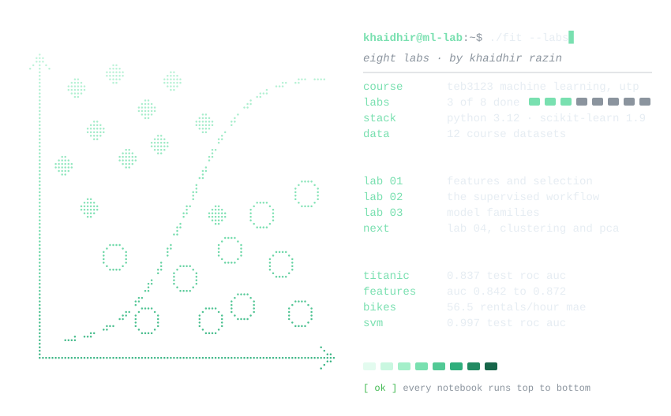
  </picture>
</div>

<div align="center">

### بِسْمِ اللَّهِ الرَّحْمَٰنِ الرَّحِيمِ
*"رَّبِّ زِدْنِي عِلْمًا"*  
*— "My Lord, increase me in knowledge." (Surah Ta-Ha 20:114)*

[](https://github.com/Aidirrr)
[](https://github.com/Aidirrr/ml-lab)
[](https://github.com/Aidirrr/ml-lab)
[](https://www.utp.edu.my)
[](#-curriculum-roadmap--milestone-progress)
[](#4-laboratory-04-unsupervised-structure-density-frontiers--pca-compression)
[](requirements.txt)

</div>

---

## ❖ Academic & Research Dossier | سجل الطالب والمساق

Welcome to the empirical machine learning research laboratory repository for **TEB3123 Machine Learning** at **Universiti Teknologi PETRONAS (UTP)**, maintained by **Muhammad Khaidhir bin Mohd Razin**.

```yaml
Candidate Information:
  Full Name:       Muhammad Khaidhir bin Mohd Razin
  Student ID:      22007399
  Programme:       Bachelor of Computer Science (Hons.)
  Department:      Computer & Information Sciences, UTP
  Course Code:     TEB3123 Machine Learning
  Evaluator / GA:  Reeyan Afzal
  Repository:      https://github.com/Aidirrr/ml-lab
```

### Philosophy of Inquiry (*Ihsan & Empirical Rigor*)
In the pursuit of beneficial knowledge (*'Ilm Nafi'*), this laboratory is grounded in three core principles:
1. **Truthfulness in Evidence (*Sidq*):** Every metric reported reflects unvarnished holdout and cross-validation evaluations. High training accuracy is never mistaken for true generalization.
2. **Methodological Excellence (*Ihsan*):** Preprocessing pipelines, scaling parameters, and imputation statistics are fitted strictly on training splits to prevent data leakage.
3. **Reproducibility (*Amanah*):** All experiments fix `random_state=42`, adhere to pinned dependency environments, and persist serializable model artifacts alongside visual evidence.

---

## ❖ Curriculum Roadmap & Milestone Progress | منهاج المختبرات

| Lab | Worked Notebook | Focus & Methodology | Primary Benchmarks | Status |
|:---:|:---|:---|:---|:---:|
| **01** | [`lab01_features_worked`](all_experiments/lab01_features_worked.ipynb) | Feature engineering, distance geometry, regularized lasso selection | Titanic, Breast Cancer Wisconsin, Student Performance |  |
| **02** | [`lab02_supervised_workflow_worked`](all_experiments/lab02_supervised_workflow_worked.ipynb) | Leak-free workflow, temporal validation, cost-sensitive threshold shifting | Medical Insurance, Bike Demand, Titanic, Breast Cancer |  |
| **03** | [`lab03_supervised_models_worked`](all_experiments/lab03_supervised_models_worked.ipynb) | Model family taxonomy, non-linear boundaries, tree pruning, SVM kernels | Breast Cancer, Titanic, Ames Housing, Red Wine |  |
| **04** | [`lab04_clustering_pca_worked`](all_experiments/lab04_clustering_pca_worked.ipynb) | Unsupervised structure: Elbow & silhouette K-Means, DBSCAN density, PCA reconstruction & downstream accuracy | Mall Customer Segmentation, Handwritten Digits (8x8) |  |
| **05** | `lab05_anomaly_limited_labels_worked` | Anomaly detection, isolation methods & semi-supervised learning | Credit Card Fraud, Breast Cancer |  |
| **06** | `lab06_reinforcement_worked` | Markov decision processes & reinforcement learning | Policy / Value Iteration |  |
| **07** | `lab07_deep_learning_cnn_worked` | Deep representation learning with Convolutional Neural Networks | Handwritten Digits |  |
| **08** | `lab08_deep_learning_lstm_worked` | Sequence modeling and temporal forecasting with LSTMs | Hourly Bike Sharing |  |

> 📌 **Standalone Inference Notebook & CLI:** [`predict_passenger.ipynb`](all_experiments/predict_passenger.ipynb) and [`scripts/predict_passenger.py`](scripts/predict_passenger.py) provide instant scoring using the serialized Lab 2 Titanic pipeline without retraining.

---

## ❖ GA Marking Rubric & Verification Index | دليل التحقق والتقييم

For direct audit by **GA Reeyan Afzal** and the course instructor, this index maps every required handout task, extension, and theoretical question to its exact implementation:

| Lab | Handout Requirement | Section & Artifact Location | Verification Notes |
|:---:|:---|:---|:---|
| **01** | **Parts A to D** | [`lab01_features_worked.ipynb`](all_experiments/lab01_features_worked.ipynb#part-a-environment-check-and-a-first-look-at-the-data) | Each part concludes with an **Observations** cell synthesizing the empirical numbers. |
| **01** | *Try it yourself:* Cabin initial & fare per family member | Part B (Cell 11–13) | Evaluated alongside raw and base engineered features; recorded in `results/lab01/summary.json`. |
| **01** | *Try it yourself:* SelectKBest ($k=5$ and $k=20$) | Part D (Cell 22–24) | MAE measured at 2.134 ($k=5$) and 2.125 ($k=20$) vs 2.181 (all features). |
| **01** | *Check your understanding:* 3 Questions | Final Section (Cell 27) | Detailed markdown answers covering distance metrics, leakage, and regularized sparsity. |
| **02** | **Parts A to E** | [`lab02_supervised_workflow_worked.ipynb`](all_experiments/lab02_supervised_workflow_worked.ipynb) | OLS vs Ridge on Insurance, Daily & Hourly Bike Demand, Titanic Classifiers, Cancer Calibration. |
| **02** | *Decision Memo:* Clinical Threshold Choice | End of Part C | Formal memo justifying the shift from 0.50 to 0.30 threshold (reducing missed malignancies by 50%). |
| **02** | *Model Persistence & Inference* | Part E, [`predict_passenger.ipynb`](all_experiments/predict_passenger.ipynb) & [`scripts/predict_passenger.py`](scripts/predict_passenger.py) | Saved to `models/titanic_survival.joblib` and documented in `titanic_survival_card.json`. |
| **02** | *Try it yourself:* Heart Disease Classifier | Section after Part E | Logistic regression pipeline yielding 0.883 accuracy and 0.932 ROC AUC. |
| **02** | *Check your understanding:* 3 Lab + Ch. 4 Questions | Final Two Sections | Comprehensive answers addressing temporal splits, calibration, and metric trade-offs. |
| **03** | **Parts A to D** | [`lab03_supervised_models_worked.ipynb`](all_experiments/lab03_supervised_models_worked.ipynb) | KNN vs Naive Bayes, Decision Tree Depth, Ensemble Regressors, Hyperplane Margin Tuning. |
| **03** | *Model Persistence:* `breast_cancer_svm.joblib` | End of Part D | RBF SVM tuned via 5-fold CV (0.995 AUC) reaching 0.997 on test holdout; reloaded and verified. |
| **03** | *Try it yourself:* Unpruned Tree & Linear SVM Sweep | *Try it yourself* Section | Unpruned tree hits 0.978 train / 0.722 val; Linear SVM ties RBF at 0.997 test ROC AUC. |
| **03** | *Verification Checklist & Questions* | Final Two Sections | Complete checklist validation and answers to all 3 theoretical questions. |
| **04** | **Parts A to C** | [`lab04_clustering_pca_worked.ipynb`](all_experiments/lab04_clustering_pca_worked.ipynb) | Elbow & silhouette sweep ($k=2..8$), DBSCAN density comparison ($eps=0.75$), PCA 95% variance budget. |
| **04** | *Try it yourself:* DBSCAN $eps=0.5$ vs K-Means | *Try it yourself* Section | At $eps=0.50$, finds 5 clusters & 66 noise points (0.528 silhouette); marketing trade-offs justified. |
| **04** | *Model Persistence:* `digits_pca_logistic.joblib` | End of Part C | Fitted PCA pipeline (29 components) achieving 0.9471 test accuracy; reloaded and verified. |
| **04** | *Verification Checklist & Questions* | Final Two Sections | Verified all 5 checklist items; complete theoretical answers to Q1, Q2, and Q3 from Ch. 15–17. |

---

## ❖ Empirical Findings & Visual Evidence | المعارض البيانية والنتائج

### 1. Laboratory 01: The Geometry of Feature Space & Parsimonious Selection

<table>
  <tr>
    <th width="50%" align="center">Feature Engineering vs Feature Sets</th>
    <th width="50%" align="center">Standardization Impact on Distance Geometry</th>
  </tr>
  <tr>
    <td></td>
    <td>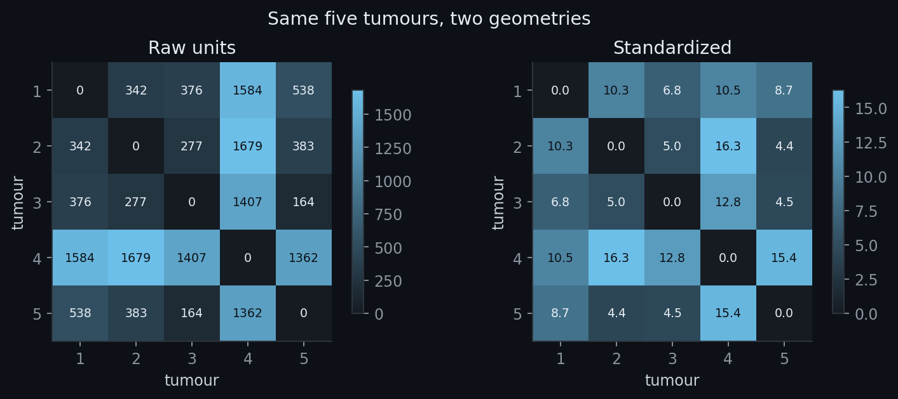</td>
  </tr>
  <tr>
    <td><b>Key Finding:</b> Extracting passenger titles, family size, and log fares elevates validation ROC AUC from <b>0.842 to 0.872</b>. Slicing cabin deck letters and individual family fares produces negligible incremental gain.</td>
    <td><b>Key Finding:</b> Without feature standardization, Euclidean distance is distorted entirely by high-magnitude tumour areas. Standardizing re-aligns nearest neighbour topology (Tumour 5 shifts from Tumour 3 to Tumour 2).</td>
  </tr>
</table>

<p align="center">
  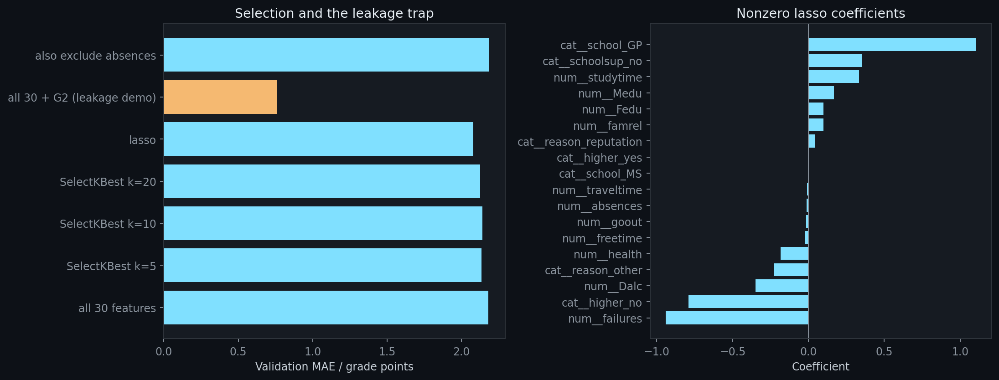
</p>

> ⚠️ **The Data Leakage Trap:** Selecting 10 to 16 features via Lasso yields superior generalization (MAE 2.08) compared to all 30 features (MAE 2.18). However, artificially including the second-period grade `G2` creates catastrophic data leakage, plummeting MAE to 0.76 with information unavailable at enrollment time.

---

### 2. Laboratory 02: Clinical Utility, Non-Linear Residuals & The Supervised Workflow

<table>
  <tr>
    <th width="50%" align="center">Classifier Evaluation Discrepancy</th>
    <th width="50%" align="center">Clinical Decision Calibration (Cancer Detection)</th>
  </tr>
  <tr>
    <td>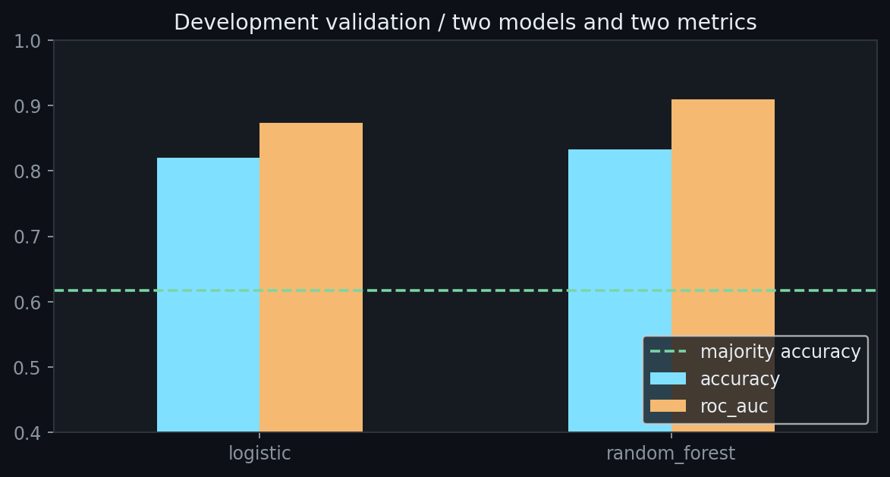</td>
    <td></td>
  </tr>
  <tr>
    <td><b>Key Finding:</b> Accuracy and ROC AUC disagree on the superior architecture: Random Forest achieves higher accuracy (0.798 vs 0.776), while Logistic Regression leads on ROC AUC (0.842 vs 0.834).</td>
    <td><b>Key Finding:</b> Shifting the decision threshold from <b>0.50 down to 0.30</b> reduces missed malignant cases by <b>50%</b> (false negatives drop from 4 to 2), preserving 0.98 precision with zero increase in false alarms.</td>
  </tr>
  <tr>
    <th align="center">Structural Non-Linearity in Residuals</th>
    <th align="center">Cross-Validation Variance Across Folds</th>
  </tr>
  <tr>
    <td></td>
    <td></td>
  </tr>
  <tr>
    <td><b>Key Finding:</b> Linear modeling on insurance charges splits smokers into two distinct residual bands: lean smokers are overcharged by ~$9,000, while high-BMI smokers are undercharged by ~$7,500.</td>
    <td><b>Key Finding:</b> Across candidate regularization parameters $C$ and class weights, score variation remains within fold standard deviations (~0.02). The selected pipeline ($C=0.1$, balanced) secures <b>0.837 test ROC AUC</b>.</td>
  </tr>
</table>

---

### 3. Laboratory 03: Boundary Geometries & Generalization Frontiers

<p align="center">
  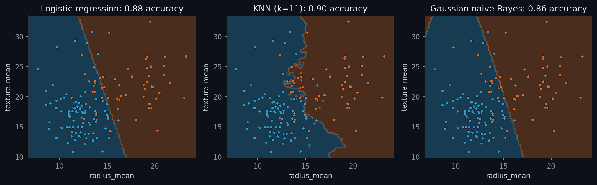
</p>

* **Logistic Regression (0.88 Acc):** Constructs a rigid planar separating hyperplane.
* **Gaussian Naive Bayes (0.86 Acc):** Generates quadratic curved frontiers driven by class covariance envelopes.
* **K-Nearest Neighbours ($k=11$, 0.90 Acc):** Conforms dynamically to local density contours, outperforming parametric baselines on non-linear geometries.

<table>
  <tr>
    <th width="50%" align="center">The Tree Overfitting Cliff</th>
    <th width="50%" align="center">Ensemble Stability Across CV Folds</th>
  </tr>
  <tr>
    <td>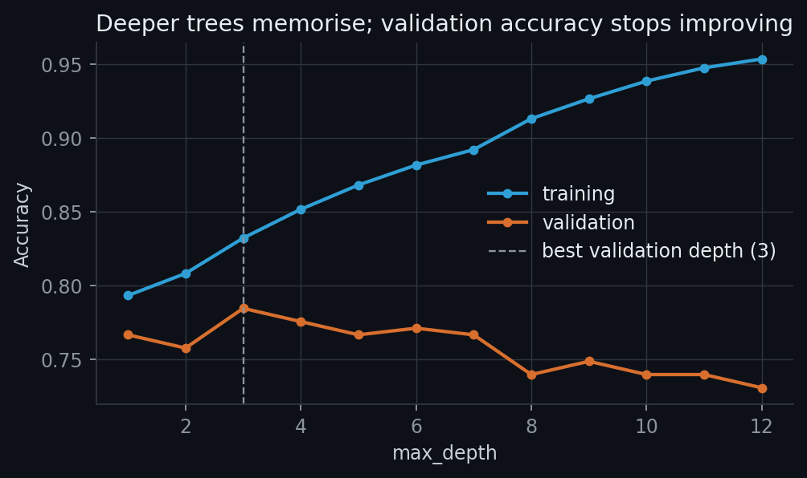</td>
    <td>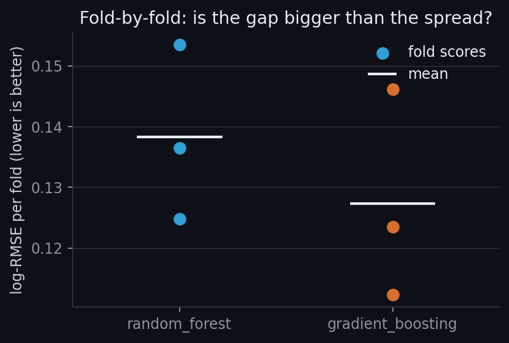</td>
  </tr>
  <tr>
    <td><b>Key Finding:</b> Unconstrained trees memorize training noise (accuracy climbing to 0.978 at depth 21), while validation performance degrades past depth 3 (peaking at 0.785, falling to 0.722).</td>
    <td><b>Key Finding:</b> Gradient boosting consistently edges out random forests across Ames folds (log-RMSE 0.127 vs 0.138), demonstrating the shrinkage power of iterative residual correction.</td>
  </tr>
</table>

---

### 4. Laboratory 04: Unsupervised Structure, Density Frontiers & PCA Compression

<p align="center">
  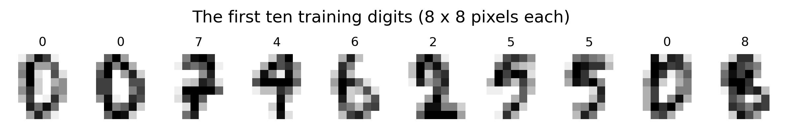
</p>

<table>
  <tr>
    <th width="50%" align="center">K-Means: Elbow &amp; Silhouette Geometry</th>
    <th width="50%" align="center">K-Means ($k=5$) vs DBSCAN ($eps=0.75$)</th>
  </tr>
  <tr>
    <td>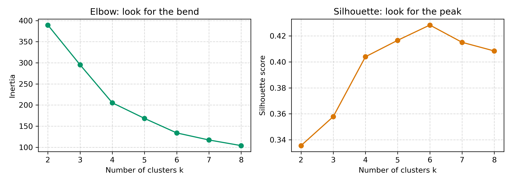</td>
    <td>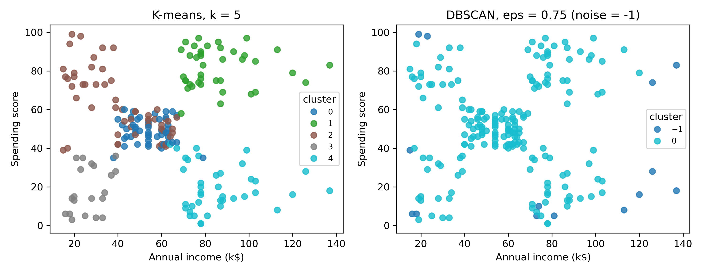</td>
  </tr>
  <tr>
    <td><b>Key Finding:</b> Inertia bends distinctly between $k=4$ and $k=6$, while silhouette scores peak at $k=6$ (0.428) closely followed by $k=5$ (0.417). Retail persona stability favors $k=5$ for intuitive marketing tiers.</td>
    <td><b>Key Finding:</b> DBSCAN at $eps=0.75$ connects density bridges across standardized 3D space, merging customers into 1 giant cloud with 14 noise points. Grouping assumptions contrast sharply with Voronoi partitioning.</td>
  </tr>
  <tr>
    <th align="center">Downstream PCA Digits Reconstruction ($8 \times 8$)</th>
    <th align="center">Cumulative Explained Variance Budget</th>
  </tr>
  <tr>
    <td>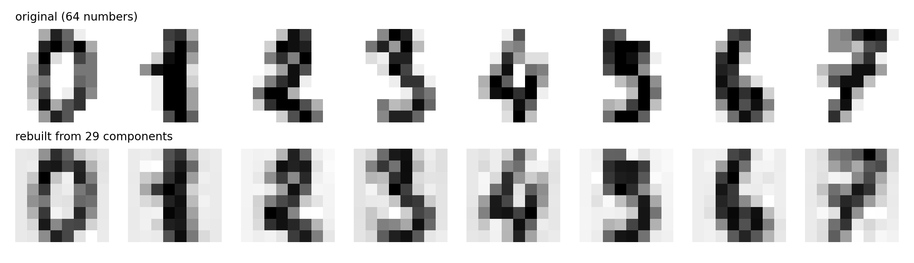</td>
    <td>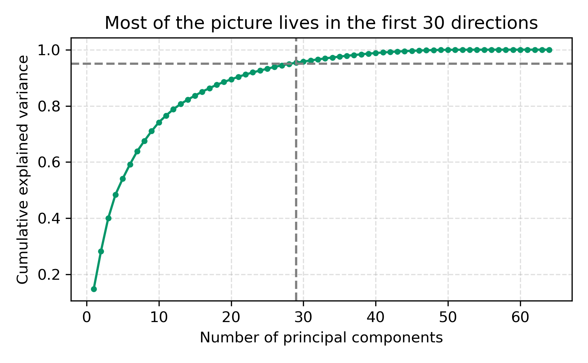</td>
  </tr>
  <tr>
    <td><b>Key Finding:</b> Compressing digits from 64 pixels down to <b>29 components</b> ($54.7\%$ compression) introduces mild high-frequency smoothing while preserving topological stroke structure.</td>
    <td><b>Key Finding:</b> The first 29 directions capture <b>95.37%</b> of total variance. Evaluated on the official holdout test file, downstream classification accuracy reaches <b>0.9471</b> (nearly identical to all 64 pixels at <b>0.9482</b>).</td>
  </tr>
</table>

<p align="center">
  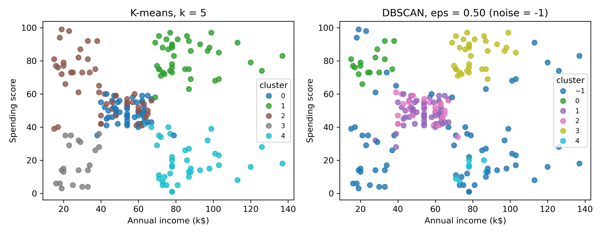
</p>

> 💡 **Try It Yourself Insight (DBSCAN $eps=0.50$):** Tightening the neighborhood radius to $eps=0.50$ isolates 5 high-density cores with 66 noise points ($33.0\%$ unclustered), achieving a silhouette score of <b>0.528</b>. K-Means serves mass retail where $100\%$ customer allocation is required; DBSCAN serves surgical VIP marketing by discarding atypical outliers.

#### Mall Customer Behavioral Profiles ($k=5$ K-Means Centroids):
| Cluster ID | Mean Age | Mean Annual Income | Mean Spending Score | Customers | Marketing Persona Interpretation |
|:---:|:---:|:---:|:---:|:---:|:---|
| **0** | 55.6 yrs | $54.4k | 48.9 / 100 | 47 (23.5%) | **Mature Mainstream:** Middle-aged stable shoppers with moderate expenditure |
| **1** | 32.9 yrs | $86.1k | 81.5 / 100 | 40 (20.0%) | **Prime Affluent / VIP:** Young high-earners with maximum disposable spending |
| **2** | 25.2 yrs | $41.1k | 62.2 / 100 | 54 (27.0%) | **Aspirational Youth:** Young moderate-income shoppers prioritizing trend consumption |
| **3** | 46.2 yrs | $26.8k | 18.4 / 100 | 20 (10.0%) | **Conservative Savers:** Low-income budget shoppers with minimal discretionary purchases |
| **4** | 39.9 yrs | $86.1k | 19.4 / 100 | 39 (19.5%) | **Careful High-Earners:** Affluent shoppers who budget strictly; prime targets for loyalty incentives |

#### PCA Variance Budgets & Downstream Classifier Performance:
| Variance Budget | Retained Components | Dimensional Compression | Validation Accuracy | Official Test Accuracy |
|:---:|:---:|:---:|:---:|:---:|
| **Baseline (Full Pixels)** | 64 | 0.0% (raw inputs) | 0.9540 | **0.9482** |
| **90% Budget** | 21 | 67.2% reduction | 0.9487 | — |
| **95% Budget (Locked)** | **29** | **54.7% reduction** | **0.9529** | **0.9471** |
| **99% Budget** | 41 | 35.9% reduction | 0.9561 | — |

---

## ❖ Empirical Benchmark Ledger | جدول المقاييس المخبرية

All performance metrics below are recorded from reproducible executions with `random_state=42`:

| Milestone | Target Domain & Dataset | Primary Model Architecture | Validation Metric | Official Test Metric | Key Finding |
|:---:|:---|:---|:---:|:---:|:---|
| **Lab 01** | Titanic Survival | Logistic Regression (Engineered) | ROC AUC: **0.872** | — | Family size & Title engineering deliver +0.03 AUC lift |
| **Lab 01** | Student Performance | Lasso Regularized Regression | MAE: **2.08** | — | 16 parsimonious features outperform all 30 features |
| **Lab 02** | Insurance Charges | OLS Linear Regression | MAE: **$4,181** | $R^2$: **0.784** | Smokers require interaction terms for non-linear BMI effects |
| **Lab 02** | Hourly Bike Demand | Random Forest Regressor | MAE: **56.5/hr** | Mean: 248.8 | Captures bi-modal morning/evening commuting demand peaks |
| **Lab 02** | Titanic Survival | Logistic Regression ($C=0.1$, balanced) | CV AUC: **0.850** | Test AUC: **0.837** | Leak-free stratified pipeline generalizes with minimal degradation |
| **Lab 02** | Breast Cancer | Cost-Sensitive Calibrated Classifier | Recall: **0.962** | Prec: **0.981** | Shifting threshold to 0.30 captures critical malignant cases |
| **Lab 03** | Breast Cancer | K-Nearest Neighbours ($k=11$) | Acc: **0.958** | AUC: **0.986** | Non-parametric local voting outscores Gaussian Naive Bayes |
| **Lab 03** | Ames Housing | Gradient Boosting Regressor | CV log-RMSE: **0.127** | — | Residual boosting outperforms standard bagging ensemble |
| **Lab 03** | Breast Cancer | Tuned RBF Support Vector Machine | CV AUC: **0.995** | Test AUC: **0.997** | Hyperplane margin maximization achieves near-flawless separation |
| **Lab 04** | Mall Customers | K-Means Clustering ($k=5$) | Silhouette: **0.417** | Inertia: **168.2** | 100% customer allocation into 5 actionable managerial personas |
| **Lab 04** | Mall Customers | DBSCAN Density Clustering ($eps=0.50$) | Clustered Sil: **0.528** | Noise: **66 pts** | High-density core isolation; filters 33% atypical outlier profiles |
| **Lab 04** | Handwritten Digits | PCA (95% Var) + Logistic Regression | Val Acc: **0.9529** | Test Acc: **0.9471** | 29 components ($55\%$ reduction) ties full 64-pixel baseline (0.9482) |

---

## ❖ Model Artifacts & Deployment | نماذج التعلم والاستدلال

Fitted pipelines are saved under [`models/`](models/) using `joblib` along with their metadata cards:

```text
models/
├── titanic_survival.joblib       # Preprocessing + Logistic Regression pipeline
├── titanic_survival_card.json    # Pipeline metadata, input schema & validation scores
├── insurance_charges.joblib      # Fitted OLS regression pipeline
├── breast_cancer_svm.joblib      # Tuned RBF Support Vector Classifier (0.997 ROC AUC)
└── digits_pca_logistic.joblib    # 29-component PCA + Logistic Regression pipeline (0.947 Acc)
```

### 1. Interactive Titanic Survival Prediction:
Execute via Jupyter Notebook [`predict_passenger.ipynb`](all_experiments/predict_passenger.ipynb) or from terminal:
```bash
python scripts/predict_passenger.py --pclass 2 --sex female --age 30 --fare 20
```
```text
survival probability: 0.822  ->  survived
(model: logistic regression pipeline, test ROC AUC 0.837)
```

### 2. Handwritten Digit Classification via PCA Pipeline:
```python
import joblib

# Load fitted PCA (29 components) + Logistic Regression pipeline
model = joblib.load("models/digits_pca_logistic.joblib")

# Predict on new 64-pixel images (values scaled 0-1)
# predictions = model.predict(new_images_64)
```

---

## ❖ Environment Setup & Reproducibility | دليل الإعداد والتشغيل

To ensure complete reproducibility matching the experimental environment:

### macOS / Linux
```bash
# 1. Clone the repository
git clone https://github.com/Aidirrr/ml-lab.git
cd ml-lab

# 2. Initialize virtual environment with Python 3.12
python3.12 -m venv .venv
source .venv/bin/activate

# 3. Install pinned dependencies
python -m pip install -r requirements.txt

# 4. Launch JupyterLab
jupyter lab all_experiments
```

### Windows (PowerShell)
```powershell
git clone https://github.com/Aidirrr/ml-lab.git
cd ml-lab
py -3.12 -m venv .venv
.venv\Scripts\Activate.ps1
python -m pip install -r requirements.txt
jupyter lab all_experiments
```

---

## ❖ Repository Architecture | هيكلية المستودع

```text
ml-lab/
├── .github/readme/              # Vector SVG banner, rosette dossier card & generator
│   ├── banner-dark.svg          # Islamic star vector banner (dark mode)
│   ├── banner-light.svg         # Islamic star vector banner (light mode)
│   ├── card-dark.svg            # Islamic geometric dossier card (dark mode)
│   ├── card-light.svg           # Islamic geometric dossier card (light mode)
│   └── build.py                 # Pure standard-library SVG artwork generator
├── all_datasets/                # The 12 official course benchmark datasets
├── all_experiments/             # Worked laboratory notebooks (strictly .ipynb format)
│   ├── lab01_features_worked.ipynb
│   ├── lab02_supervised_workflow_worked.ipynb
│   ├── lab03_supervised_models_worked.ipynb
│   ├── lab04_clustering_pca_worked.ipynb
│   └── predict_passenger.ipynb  # Interactive passenger inference notebook
├── models/                      # Serialized pipelines and model cards
├── results/                     # High-resolution visual artifacts and metric summaries
│   ├── lab01/
│   ├── lab02/
│   ├── lab03/
│   └── lab04/
├── scripts/                     # Standalone helper and CLI inference scripts
│   └── predict_passenger.py     # Terminal inference client
├── requirements.txt             # Course dependencies pinned to reproduction versions
└── README.md                    # Academic dossier and laboratory documentation
```

---

## ❖ Academic Integrity, References & Data Credits | الأمانة العلمية والمراجع

All datasets utilized in this laboratory are part of the UTP TEB3123 course curriculum and originated from the following public repositories:
* **Titanic Dataset:** [Kaggle / Yasser Hesham](https://www.kaggle.com/datasets/yasserh/titanic-dataset)
* **Breast Cancer Wisconsin:** [UCI ML Repository / Kaggle](https://www.kaggle.com/datasets/uciml/breast-cancer-wisconsin-data)
* **Student Performance:** [UCI / Paulo Cortez](https://www.kaggle.com/datasets/larsen0966/student-performance-data-set)
* **Medical Cost Personal:** [Miri Choi / Kaggle](https://www.kaggle.com/datasets/mirichoi0218/insurance)
* **Bike Sharing Demand:** [UCI / Hadi Fanaee-T](https://www.kaggle.com/datasets/lakshmi25npathi/bike-sharing-dataset)
* **Heart Failure Prediction:** [Fedesoriano / Kaggle](https://www.kaggle.com/datasets/fedesoriano/heart-failure-prediction)
* **Ames Housing:** [Dean De Cock / Kaggle](https://www.kaggle.com/datasets/shashanknecrothapa/ames-housing-dataset)
* **Red Wine Quality:** [UCI / Paulo Cortez](https://www.kaggle.com/datasets/uciml/red-wine-quality-cortez-et-al-2009)
* **Mall Customers (Lab 04):** [Kaggle](https://www.kaggle.com/datasets/vjchoudhary7/customer-segmentation-tutorial-in-python)
* **Optical Recognition of Handwritten Digits (Lab 04):** [UCI / Kaggle](https://www.kaggle.com/datasets/yadavhim/optical-recognition-of-handwritten-digits)

**Statement of Authorship:** All analysis, markdown commentary, code modifications, visual figures, and synthesized insights in this repository represent the independent academic work of **Muhammad Khaidhir bin Mohd Razin** (Student ID: **22007399**), submitted in partial fulfillment of the requirements for TEB3123 Machine Learning.

<div align="center">
  <sub>وَآخِرُ دَعْوَانَا أَنِ الْحَمْدُ لِلَّهِ رَبِّ الْعَالَمِينَ</sub><br>
  <sub>All praise is due to Allah, the Lord of all the worlds.</sub>
</div>
